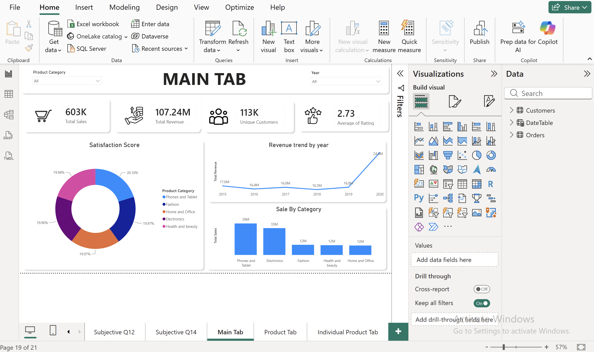
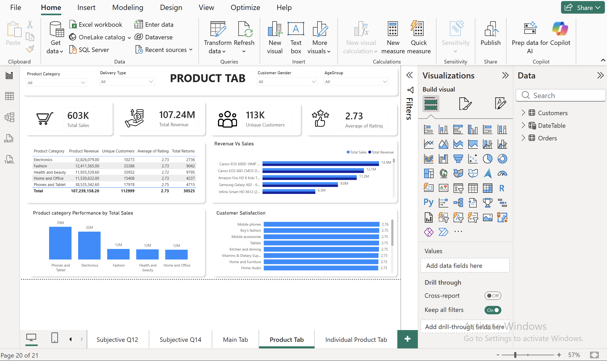
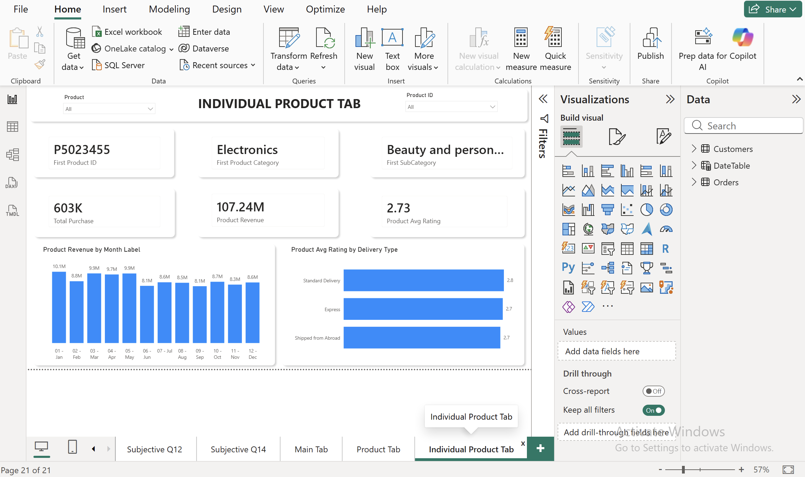

# 🛒 E-commerce Amazon Analysis — Power BI + SQL

> Power BI and SQL analysis of 113K e-commerce orders to uncover sales, customer and product insights.

---

## 📌 Project Overview

Amazon sells across many products, customers and regions, and growth depends on knowing which of them drive revenue.
This project uses Power BI (DAX) and MySQL to analyze 113K+ orders and answer one question: **What drives sales and where should the business focus to grow?**

---

## 🛠️ Tools & Concepts Used

| Category | Details |
|---|---|
| Visualization | Power BI Desktop |
| Database | MySQL |
| Concepts | Star Schema, DAX Measures, Time Intelligence, Calculated Columns |
| KPIs Built | Total Sales, Total Returns, Unique Customers, Avg Delivery Time, Product Avg Rating, Previous Year Sales |
| Analysis Type | Objective Queries + Subjective Business Questions |

---

## 🗄️ Data Model — Star Schema

| Table | Type | Contents |
|---|---|---|
| `Orders` | Fact | Order details, product, sale price, shipping fee, delivery, status, rating |
| `Customers` | Dimension | Customer age, age group, gender |
| `DateTable` | Dimension | Date, month, month label, year |

**Relationships:** `Customers` → `Orders` (one-to-many on CustomerID) and `DateTable` → `Orders` (one-to-many on order date).

---

## 📐 Key DAX Measures

| Measure | Purpose |
|---|---|
| `Total Sales` | Sum of sale price |
| `Previous Year Sales` | Prior-year comparison for YoY growth |
| `Total Returns` | Count of orders with status "Returned" |
| `Unique Customers` | Distinct customer count |
| `Avg Delivery Time` | Average days from order to delivery |
| `Product Avg Rating` | Average customer rating per product |

---

## 📊 Dashboard Preview

### Main Tab

### Product Analysis

### Individual Product Drill-through

---

## 🔍 Analysis Covered

- **Sales performance:** monthly and yearly trends with year-over-year comparison
- **Product analysis:** revenue, ratings and returns by category and sub-category
- **Customer insights:** age group and gender breakdown, unique customers
- **Operations:** delivery time and delivery type performance
- **Subjective business questions:** answered with DAX and SQL, with full written answers in the report

---

## 📁 Project Files

| File | Description |
|---|---|
| `E-Commerce_Tushar.pbix` | Power BI dashboard with data model and DAX measures |
| `E-Commerce_Tushar.sql` | SQL queries |
| `E-Commerce_Tushar.pptx` | Slide deck with charts and insights |
| `E-Commerce_Tushar.docx` | Detailed written answers with analysis |
| `Screenshots/` | Dashboard page images |

---

## 👨‍💻 Author

**Tushar Naha**

Data Analytics Enthusiast
